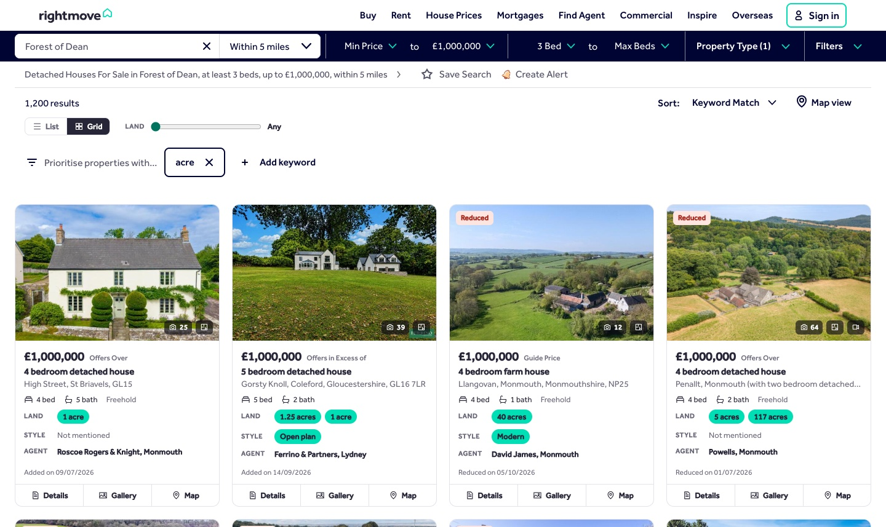
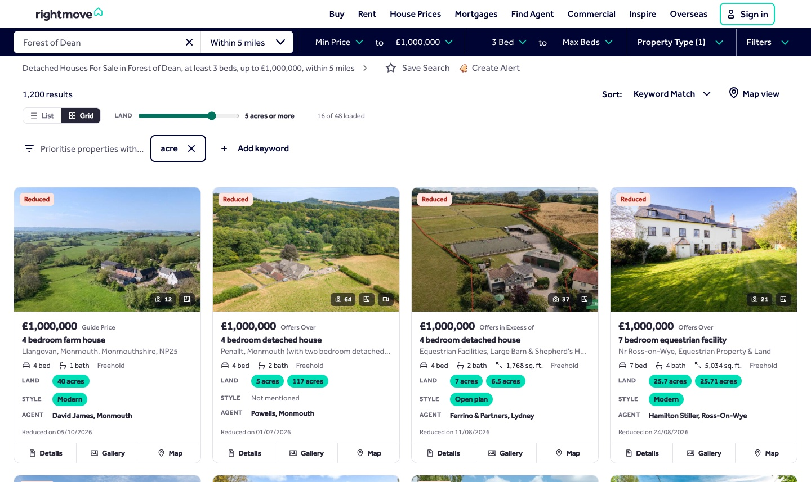
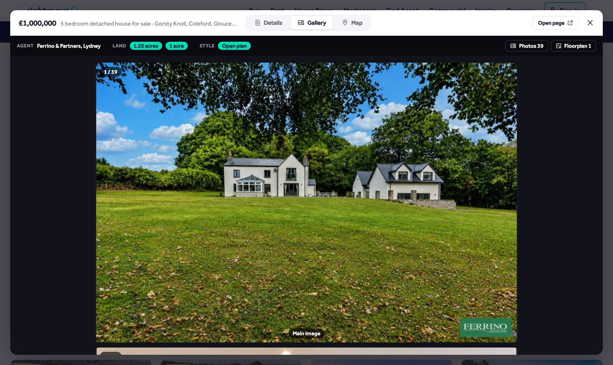
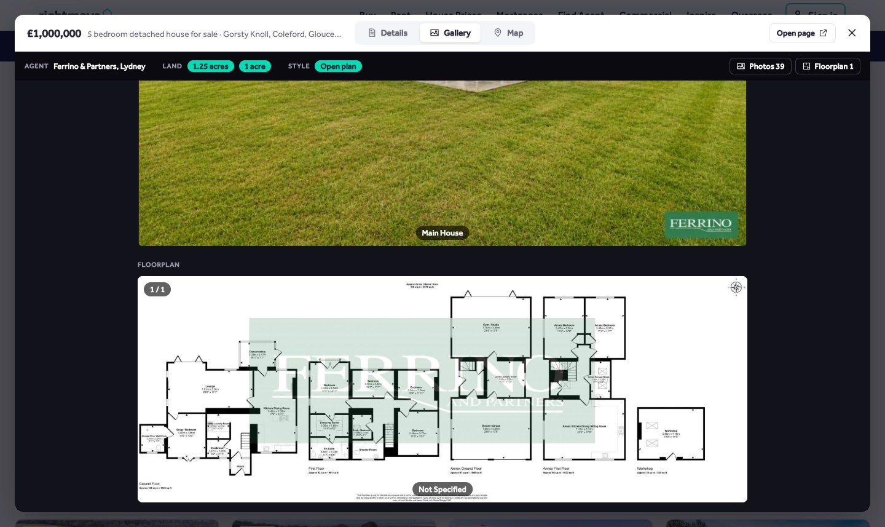
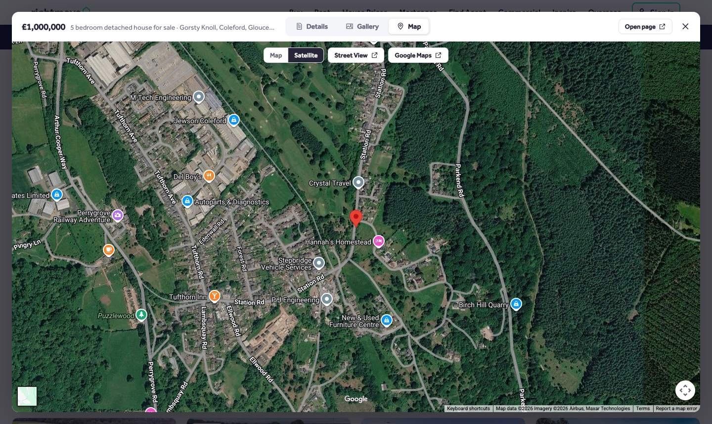
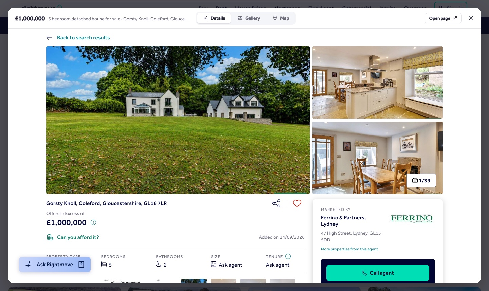
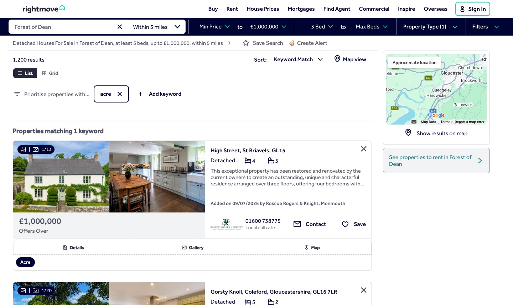
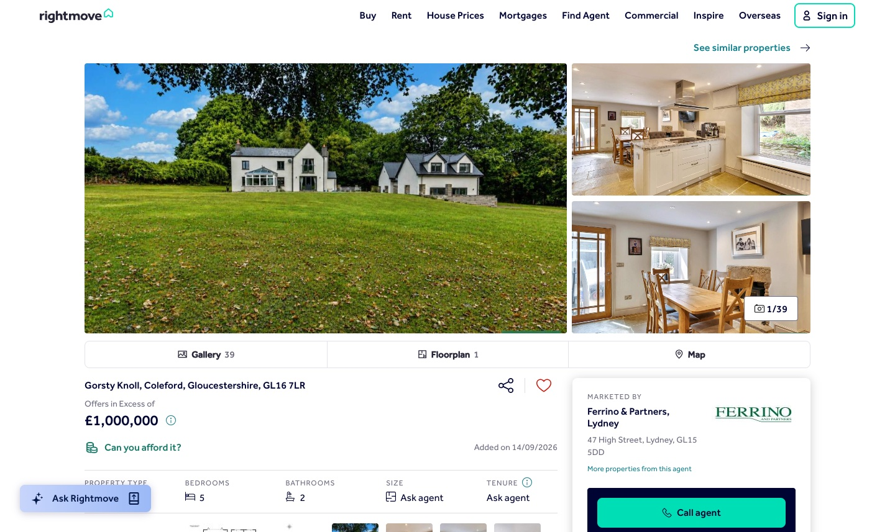

  

# Rightmove Plus

A Chrome extension that makes Rightmove easier to browse. Search results become a full-width grid that keeps scrolling through every result. Each card shows the land its listing mentions, and you can filter by acres. Photos, floorplans and maps open in a quick-look window without leaving the page, and the adverts are gone.

## Grid view

Search results (sale and rent) as a grid of cards, using the full window width. A **List / Grid** toggle sits under the results count, and your choice is remembered.

- **No pages to click through.** The next page loads as you near the bottom, always starting from the first page (even if the URL is on a later one). Rightmove lists at most 1,008 properties (42 pages) for one search; the end of the grid says when you've reached that.
- **Land** shows the acres given in the listing's key features, summary and full description, highlighted: "4 acres", "0.5 acres" for "half an acre", "1–2 acres". Hover one for the sentence it came from. Otherwise it says "No acres mentioned", or "“Acre” mentioned, no amount".
- **Style** highlights **Open plan** (open plan, open-plan, openplan) and **Modern** (the word itself, not "modernised") when the listing mentions them. Hover for the sentences.
- **Agent** shows the branch marketing the property.

The full description lives on the property's own page, so it's fetched as cards scroll into view and a card can show "Checking details…" for a moment. If a listing's page can't be read, the card says "Couldn't read listing" (hover for why) and only its search summary counts.

## Land filter

The **Land** slider next to List / Grid hides cards with less land than you choose, from 0.1 to 50 acres, or Any. It goes by the largest amount in acres each listing mentions, and your setting is remembered.

While it's set, every loaded listing's description is checked, not just the ones on screen. The next page only loads once they have been, so a high setting keeps loading pages until enough matches fill the screen. The count beside the slider shows the matches so far ("16 of 48 loaded").

The largest amount can be land the property doesn't own, such as "set within a 270-acre estate", so check the highlighted sentence before getting excited.

## Quick look

Every property has **Details**, **Gallery** and **Map** buttons, in grid and list view alike. Clicking a card's photo or title opens Details. They open a window over the results, with tabs to switch between the three. **Open page** opens the normal property page in a new tab, and `Esc` closes the window. Cmd/Ctrl-click or middle-click a property to open it in a new tab as usual.

### Gallery

Every photo, then the floorplans, full size in one column you scroll up and down. ← → move a photo at a time, and the **Photos** / **Floorplans** buttons jump to either. The strip above the photos shows the same Agent, Land and Style as the card.

### Map and Details

| Map | Details |
| --- | --- |
|  |  |
| A Google Map of the property with a **Satellite** toggle, and links to **Street View** and **Google Maps**. | The real property page, without the site header and footer. |

## List view and property pages

| List view | Property page |
| --- | --- |
|  |  |
| Rightmove's own list keeps working, with the same **Details**, **Gallery** and **Map** buttons under each card. | A **Gallery / Floorplans / Map** bar under the photos opens the same window (without Details, since you're already on the page). Rightmove's own photo, floorplan and map links open it too, at the photo or plan you clicked. Videos, virtual tours and Street View still use Rightmove's viewer. |

## No adverts

Ad networks are blocked on rightmove.co.uk (`rules/ads.json`). Leftover ad slots, the in-feed and sidebar ads, agent brand banners and the paid "Featured property" slot are hidden (`src/site.css`).

## Install

1. Open `chrome://extensions`.
2. Turn on **Developer mode** (top right).
3. Click **Load unpacked** and select this folder.

After editing any file, click the reload icon on the extension's card and refresh Rightmove.

## How it works

| File | Role |
| --- | --- |
| `src/search.js` | Search pages: the grid with infinite scroll, the toolbar (List / Grid and the land slider) and the card buttons. Reads results from the page's `__NEXT_DATA__`, then from `/api/property-search/listing/search` for later pages and when you change filters. |
| `src/property.js` | Property pages: the Gallery / Floorplans / Map bar, and routes Rightmove's `#/media`, `#/floorplan` and `#/map` links to the quick-look window. |
| `src/ui.js` | The quick-look window (Details, Gallery, Map), the land and style badges, and DOM helpers, shared by both pages. |
| `src/acres.js` | Finds amounts in acres in a listing's text, as labels and values for the cards, the gallery and the land filter. Rightmove's own size in acres is the floor area converted, so it isn't used. Also finds mentions of open plan and modern (Style). |
| `src/model.js` | Decodes a property page's embedded `__PAGE_MODEL` (photos, floorplans, location, description): read from the current page on a property page, fetched otherwise. |
| `src/frame.js` | Marks a property page shown inside the quick-look window so the header and footer are hidden. |
| `src/site.css` | Hides ad slots on every Rightmove page and frame. |
| `src/ui.css` | Styles for the quick-look window and the shared buttons and badges. |
| `src/search.css` | Styles for the grid and toolbar. |
| `src/property.css` | Styles for the property page bar. |
| `rules/ads.json` | Network rules that block ad requests initiated by rightmove.co.uk. |

Rightmove's class names include build hashes, so the extension matches them by prefix (e.g. `[class*="ResultsList_resultsColumn"]`). If Rightmove changes its markup and something stops working, the grid falls back to the normal list. Property page class names are fully hashed, so `property.js` relies on `data-testid="photo-collage"` and the `#/…` link targets instead.

The screenshots show a search for detached houses in the Forest of Dean, prioritising the keyword "acre".
